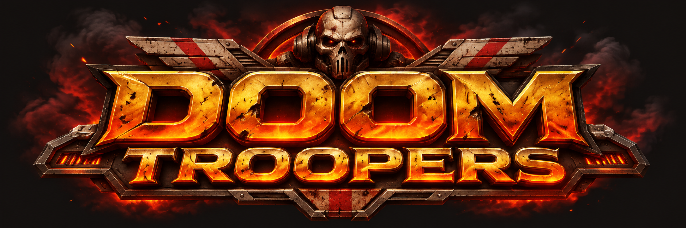
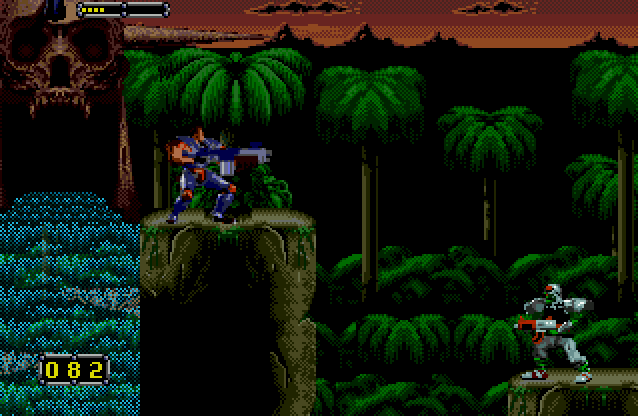
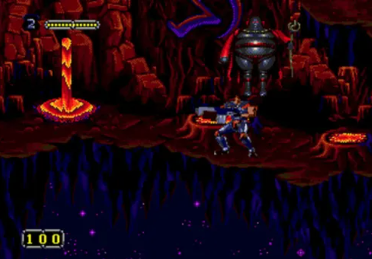
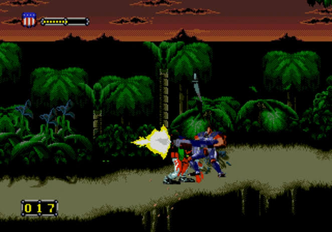
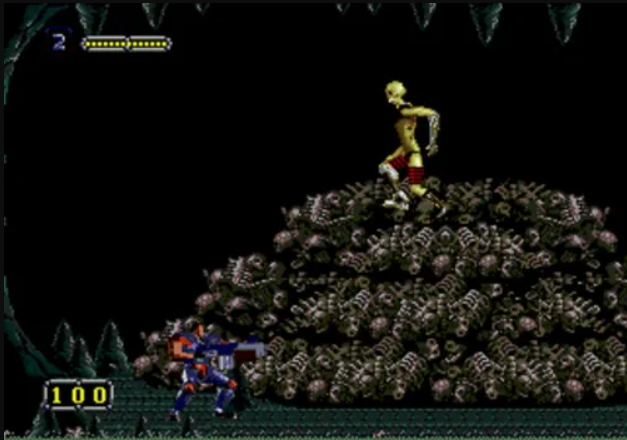

[Português (Brasil)](README.md) · **English**



# Doom Troopers PC Recomp

A PC recompilation of *Mutant Chronicles: Doom Troopers* for the Sega Genesis / Mega Drive. The portable **v0.1.11 Integrated** release for **Windows x64** restores game audio. Save states from the published v0.1.10 executable use an incompatible format. To resume those states, use v0.1.10 in a separate folder.

**[Download for Windows x64 (ZIP)](https://github.com/emanuelcnjunior/Doom-Troopers-PC-Recomp/releases/download/v0.1.11/Doom-Troopers-PC-Recomp-v0.1.11-Windows-x64-Integrated.zip)** · [SHA-256](https://github.com/emanuelcnjunior/Doom-Troopers-PC-Recomp/releases/download/v0.1.11/Doom-Troopers-PC-Recomp-v0.1.11-Windows-x64-Integrated.zip.sha256) · [Release notes](https://github.com/emanuelcnjunior/Doom-Troopers-PC-Recomp/releases/tag/v0.1.11)

<a href="https://recomplauncher.com"><picture><source media="(prefers-color-scheme: dark)" srcset="https://recomplauncher.com/assets/press/launcher/badge-light.svg"></picture></a>

## Quick start

Bring your own legally obtained, uncompressed **Doom Troopers (USA)** ROM in `.md`, `.bin` or `.gen` format. The ZIP includes SDL2 and the Visual C++ runtime libraries.

1. Extract the entire ZIP to a folder where you can save files.
2. Open `DoomBootProbe.exe` and select **English** at the top of the window.
3. In **Game**, select your ROM. The menu checks its size and SHA-256 against the US revision.
4. Select **Play** to save your settings and start the game.

<details>
<summary>Launch from PowerShell or check your ROM revision</summary>

From the extracted folder, pass the ROM path in quotes. When launched from the command line, the game checks the ROM size and CRC32.

```powershell
.\DoomBootProbe.exe "D:\Games\Doom Troopers (USA).md"
```

US ROM: **2 MiB** · CRC32 `11194414`. [Full ROM fingerprint](config/rom_identity.json)

</details>

In the local development build, the **Game** tab offers **Classic** and **Enhanced**. Classic presents the original frame in 4:3 without filtering. Enhanced adds optional Scale2x. Select **Play** to save the profile.

Enhanced also supports local OGG Vorbis, WAV and MP3 music and effects. [Audio mod setup and sequence IDs (Portuguese)](docs/modding.md)

## Controls

| Action | Keyboard | PS4 controller (player 1) |
| --- | --- | --- |
| Move | Arrow keys | D-pad |
| Start | Enter | Options |
| Shoot | X | Square |
| Jump | C | Cross |
| Attack | Z | Circle |
| Save to slot 1 | Shift + F1 | L2 |
| Load slot 1 | F1 | R2 |

In **Controls**, assign three distinct keys and three distinct controller buttons to shoot, jump and attack. In **Game**, choose the display mode and toggle the Scale2x filter. Press **F11** during play to toggle fullscreen.

In **Cheats**, double-click an option or select **Toggle**. The player 1 energy cheat has been tested. **Skip levels** is disabled due to instability, and the other effects still need individual testing.

To transfer your preferences, close the game and copy `launcher.ini` and `settings.ini`. These files may contain your local ROM path.

## Screenshots

| Jungle | Caverns |
| :---: | :---: |
| [](image/screenshot1.png) | [](image/screenshot2.png) |
| [](image/screenshot3.png) | [](image/screenshot4.png) |

## Build and validation

For v0.1.7, the Release build and all four CTest checks passed. The automated test saved and restored a game state. The gameplay script reached frame 4,402, with four screenshots matching the Direct release candidate. Testing on a second Windows x64 PC, with a physical display and audio output, and with a PS4 controller for navigation, remapping and L2/R2 is still pending. [Build instructions and test report](docs/integrated-menu-v0.1.7.md)

<details>
<summary>Download integrity and scan history</summary>

SHA-256 of the ZIP: `20f4706c4285a9010c59955aa29b28b69ca55370eb68edeec4505eb24405a236`

On November 20, 2026, VirusTotal reported 0/70 detections for the executable and 0/66 for the ZIP. These results reflect the scans on that date. [Executable](https://www.virustotal.com/gui/file/f543d5f75003e081265ec790d061dbc4c0b5da2ede800a559a49c3c1a2b0f97a) · [ZIP](https://www.virustotal.com/gui/file/20f4706c4285a9010c59955aa29b28b69ca55370eb68edeec4505eb24405a236) · [v0.1.6 audit](docs/security-audit-v0.1.6.md)

</details>

## Project and credits

This project explores recompiling the game’s Motorola 68000 code. TMNT IV PC Recomp inspired the organization of the project’s own code, local generation and documentation. The projects share no copied code or assets. [TMNT IV PC Recomp](https://github.com/emanuelcnjunior/TMNT-IV-Turtles-in-Time-PC-Recomp)

The package’s `LICENSES.txt` contains the framework’s PolyForm Noncommercial license and notices for the bundled libraries. The game belongs to its respective rights holders. **Distribution rights for the recompiled game instructions embedded in the executable remain under review.**

[Architecture](docs/architecture.md) · [Boot experiment](docs/boot-experiment.md) · [Research](docs/research.md) · [Audit](docs/audit.md) · [Comparison protocol](docs/validation.md)
