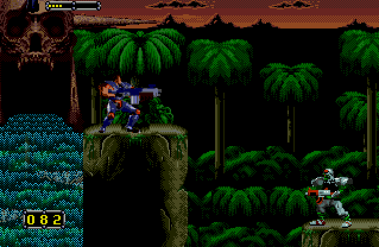
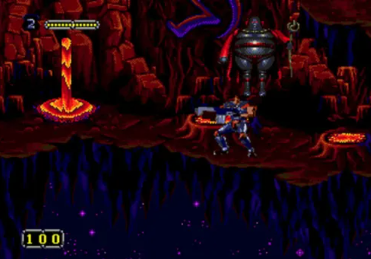
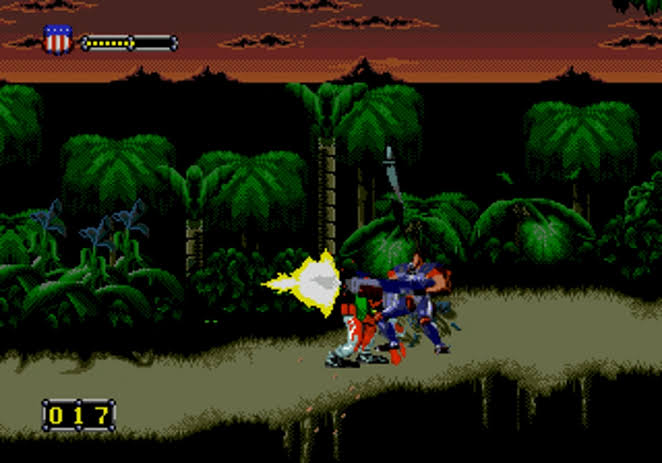
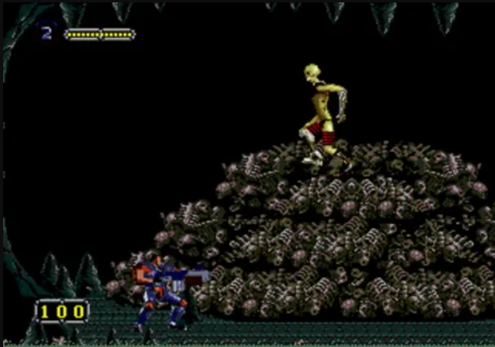

**Português (Brasil)** · [English](README.en.md)


# Doom Troopers PC Recomp

Uma recompilação para PC de *Mutant Chronicles: Doom Troopers*, do Sega Genesis / Mega Drive. A edição portátil **v0.1.10 Integrated** reúne o jogo e o menu de configuração em um único executável para **Windows x64** e inclui a correção validada da transição da fase 1 para Resultados e fase 2.

**[Baixar para Windows x64 (ZIP)](https://github.com/emanuelcnjunior/Doom-Troopers-PC-Recomp/releases/download/v0.1.10/Doom-Troopers-PC-Recomp-v0.1.10-Windows-x64-Integrated.zip)** · [SHA-256](https://github.com/emanuelcnjunior/Doom-Troopers-PC-Recomp/releases/download/v0.1.10/Doom-Troopers-PC-Recomp-v0.1.10-Windows-x64-Integrated.zip.sha256) · [Notas da versão](https://github.com/emanuelcnjunior/Doom-Troopers-PC-Recomp/releases/tag/v0.1.10)

<a href="https://recomplauncher.com"><picture><source media="(prefers-color-scheme: dark)" srcset="https://recomplauncher.com/assets/press/launcher/badge-light.svg"></picture></a>

## Como jogar

Você precisa de uma ROM descompactada de **Doom Troopers (USA)**, obtida legalmente, em formato `.md`, `.bin` ou `.gen`. O ZIP inclui SDL2 e as bibliotecas do Visual C++. A ROM é fornecida pelo jogador.

1. Extraia todo o conteúdo do ZIP para uma pasta onde você possa salvar arquivos.
2. Abra `DoomBootProbe.exe` e escolha **Português** no topo da janela.
3. Na aba **Jogo**, selecione sua ROM. O menu verifica o tamanho e o SHA-256 da revisão americana.
4. Clique em **Jogar** para salvar suas preferências e iniciar a partida.

<details>
<summary>Iniciar pelo PowerShell ou conferir a revisão da ROM</summary>

Na pasta extraída, passe o caminho da ROM entre aspas. Ao iniciar pela linha de comando, o jogo verifica o tamanho e o CRC32 da ROM.

```powershell
.\DoomBootProbe.exe "D:\Jogos\Doom Troopers (USA).md"
```

ROM americana: **2 MiB** · CRC32 `11194414`. [Identificação completa da ROM](config/rom_identity.json)

</details>

## Controles

| Ação | Teclado | Controle de PS4 (jogador 1) |
| --- | --- | --- |
| Mover | Setas | Direcional |
| Iniciar | Enter | Options |
| Atirar | X | Quadrado |
| Pular | C | Cruz |
| Atacar | Z | Círculo |
| Salvar no slot 1 | Shift + F1 | L2 |
| Carregar o slot 1 | F1 | R2 |

Em **Controles**, você pode atribuir três teclas e três botões distintos às ações de atirar, pular e atacar. Em **Jogo**, escolha o modo de exibição e o filtro Scale2x. Pressione **F11** durante a partida para alternar a tela cheia.

Em **Cheats**, clique duas vezes em uma opção ou use **Ativar/desativar**. O efeito de energia do jogador 1 foi testado. **Pular fases** está desabilitado por instabilidade, e os demais efeitos ainda precisam de testes individuais.

Para transferir suas preferências, feche o jogo e copie `launcher.ini` e `settings.ini`. Esses arquivos podem conter o caminho local da ROM.

## Galeria

| Selva | Cavernas |
| :---: | :---: |
| [](image/screenshot1.png) | [](image/screenshot2.png) |
| [](image/screenshot3.png) | [](image/screenshot4.png) |

## Build e validação

Na v0.1.7, a compilação Release e os quatro testes CTest passaram. O teste automatizado salvou e restaurou uma partida. O roteiro de gameplay chegou ao quadro 4.402, com quatro capturas idênticas às da versão candidata Direct. Ainda faltam testes em outro PC Windows x64, em monitor e saída de áudio físicos e com um controle PS4 para conferir navegação, remapeamento e L2/R2. [Instruções de build e relatório de testes](docs/integrated-menu-v0.1.7.md)

<details>
<summary>Integridade do download e histórico de verificação</summary>

SHA-256 do ZIP: `20f4706c4285a9010c59955aa29b28b69ca55370eb68edeec4505eb24405a236`

Em 20 de novembro de 2026, o VirusTotal registrou 0/70 detecções para o executável e 0/66 para o ZIP. Os resultados refletem a análise daquela data. [Executável](https://www.virustotal.com/gui/file/f543d5f75003e081265ec790d061dbc4c0b5da2ede800a559a49c3c1a2b0f97a) · [ZIP](https://www.virustotal.com/gui/file/20f4706c4285a9010c59955aa29b28b69ca55370eb68edeec4505eb24405a236) · [Auditoria da v0.1.6](docs/security-audit-v0.1.6.md)

</details>

## Projeto e créditos

O projeto investiga a recompilação do código Motorola 68000 do jogo. A organização do código próprio, a geração local e a documentação foram inspiradas no TMNT IV PC Recomp, sem reutilizar código ou recursos daquele projeto. [TMNT IV PC Recomp](https://github.com/emanuelcnjunior/TMNT-IV-Turtles-in-Time-PC-Recomp)

O arquivo `LICENSES.txt` do pacote reúne a licença PolyForm Noncommercial do framework e os avisos das bibliotecas distribuídas. Os direitos do jogo pertencem aos respectivos titulares. **Os direitos de distribuição das instruções recompiladas do jogo incorporadas ao executável continuam em revisão.**

[Arquitetura](docs/architecture.md) · [Experimento de execução](docs/boot-experiment.md) · [Pesquisa](docs/research.md) · [Auditoria](docs/audit.md) · [Protocolo de comparação](docs/validation.md)
